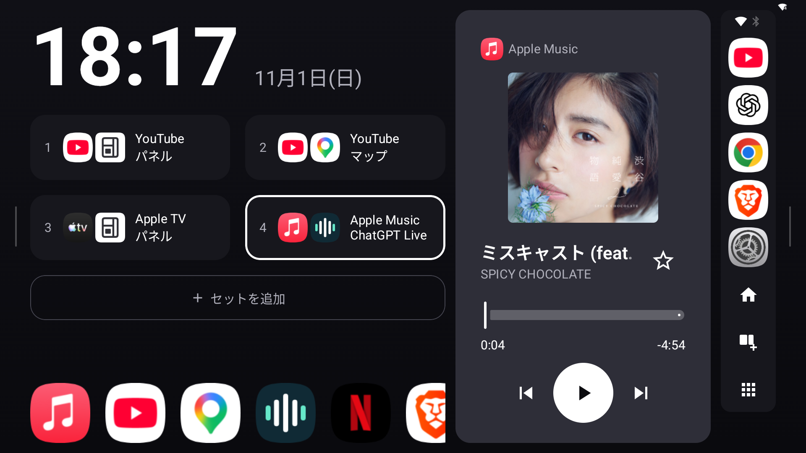
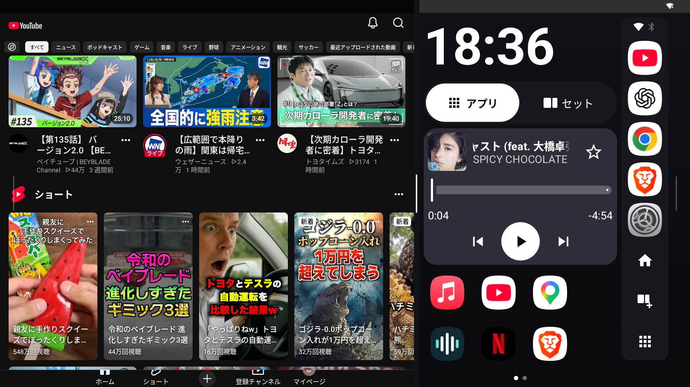
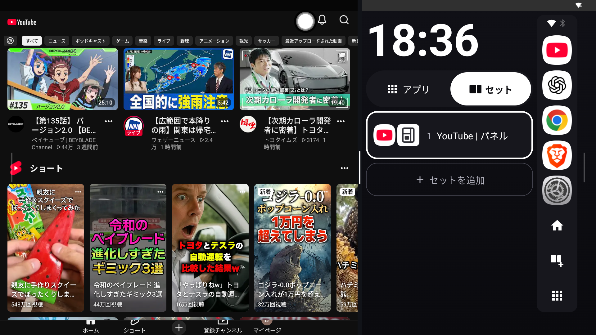
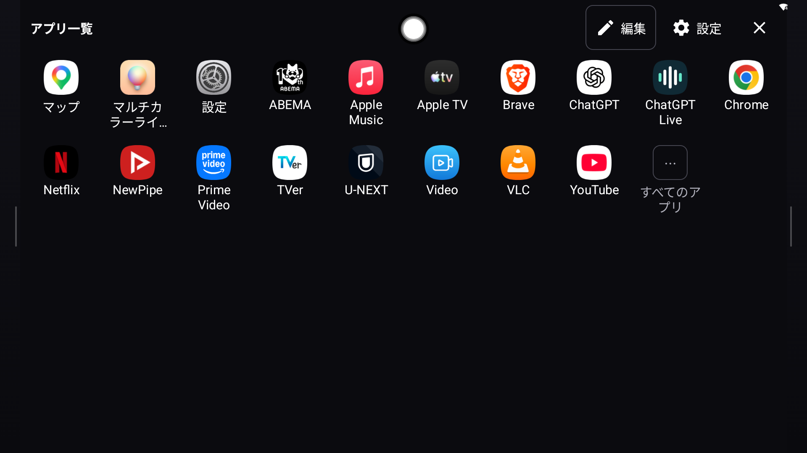
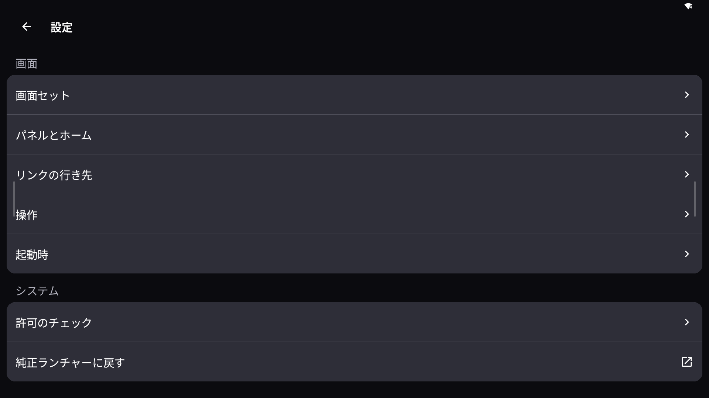

# YLuncher

GT8D（Android 15）用のカスタムランチャー、v1.7.1。左右の分割を「画面セット」として保存し、ひと押しで呼び出せます。



| アプリとパネル | セット表示 |
| --- | --- |
|  |  |
| 左に YouTube、右に必要な操作をまとめて。 | パネルから次の組み合わせを選ぶ。 |
| **アプリ一覧** | **設定** |
|  |  |
| アプリを選び、編集や設定へ。 | 画面セットや操作を、自分に合わせる。 |

- **画面セット**：左右のアプリ・比率・パネルの位置と、仕切りのダブルタップで入れ替えた左右をまとめて保存し、ひと押しで再現できます。
- **リンクは隣に開く**：今のアプリを残したまま、設定で選んだ外部ブラウザを分割の反対側に開けます。
- **パネル**：時計・ミニプレイヤー・アイコン・ドックを狭い幅にまとめて左右どちらにも置けて、アプリとセットの表示を切り替えられます。
- **端のジェスチャ**：ほかのアプリを使っていても、画面の端から次・前のセットやホームへ移動できます。
- **ミニプレイヤー**：ホームとパネルに再生中や停止中の曲を表示し、ジャケットから再生アプリを開いたり、お気に入りに登録したりできます。
  ホームのミニプレイヤーの歌詞ボタンで歌詞表示をオンにすると、再生中の曲名・アーティスト・アルバム名・長さを LRCLIB(lrclib.net)に送って歌詞を探します。オフ(既定)の間は送りません。
- **よく使うアプリが自動でドックに**：直近7日間の使い方から、よく使うアプリをドックに並べます。

## 使い方の流れ

1. **設定でセットを作る**：左右のアプリと比率を選び、いつもの組み合わせを保存します。
2. **セットを呼び出す**：ホームのカードを押すか、端のジェスチャで呼び出します。
3. **リンクやアプリは隣に開く**：今の画面を使いながら、もう片方の画面へ開きます。

## 導入

動作環境は GT8D・Android 15 です。同じ署名鍵で署名した release 版の APK を、本体 → 中継の順にインストールし、通知へのアクセスを許可します。

```sh
adb install -r app/build/outputs/apk/release/app-release.apk
adb install -r panelhost/build/outputs/apk/release/panelhost-release.apk
adb shell cmd notification allow_listener com.gt8d.launcher/com.gt8d.launcher.media.MediaListenerService
```

初回は「使用状況へのアクセス」「通知へのアクセス」「ほかのアプリの上に表示」「通知」を許可してください。再インストール後は、通知へのアクセスを許可し直します。

PiP(小窓)で再生中のアプリをパネルから開いたとき、小窓を解いて分割に戻すには、設定 → ユーザー補助 → 「YLuncher(PiP の判定)」を有効にします(任意。画面の内容は読み取りません)。

YLuncher を既定のホームに設定します。

```sh
adb shell cmd role add-role-holder android.app.role.HOME com.gt8d.launcher 0
```

詳しくは [v1.6 導入手順](docs/install-v1.6.md) を参照してください。

## よくある質問

<details>
<summary>なぜアプリが2つあるの？</summary>

純正の分割は右側のアプリを「既存のタスク」から選びます。パネルを独立したアプリ（中継）にして、その中にパネルを開くことで、分割の右側に安定して置けます。

</details>

<details>
<summary>再起動の後にセットが開かない</summary>

既定のホームが YLuncher だと、再起動後に純正ランチャーが一度も開かれず、純正の分割が反応しません。v1.6.2 から、必要なときだけ純正ランチャーを一瞬開いて準備します。

</details>

<details>
<summary>音楽が表示されない</summary>

再インストールで通知へのアクセスが外れます。通知へのアクセスを許可し直してください。

</details>

<details>
<summary>分割が失敗したら？</summary>

幕が閉じて知らせが出ます。もう一度押すか、設定の「許可のチェック」を確認してください。

</details>

<details>
<summary>純正のホームに戻したい</summary>

設定の「純正ランチャーに戻す」を選んでください。

</details>

## 開発者向け

### 構成

| モジュール | パッケージ | 役割 |
| --- | --- | --- |
| `:app` | `com.gt8d.launcher` | ランチャー本体 |
| `:panelhost` | `com.gt8d.launcher.panel` | パネルを開く中継アプリ |

### 使っている技術

- Kotlin 2.1.0、Android Gradle Plugin（AGP）8.7.3
- Jetpack Compose
- DataStore + kotlinx.serialization
- Robolectric による JVM テスト
- minSdk 35（Android 15）

### ビルドとテスト

JVM テストと debug 版のビルド：

```sh
./gradlew test assembleDebug
```

release 版のビルド：

```sh
./gradlew assembleRelease
```

リリースの署名には、Git に含めない `keystore.properties` を使います。署名鍵も Git に含めません。`keystore.properties` がない場合は、debug の署名鍵が使われます。

### 実機の場面テスト

[scripts/device-scenarios.sh](scripts/device-scenarios.sh) を使います。デバッグ版が必要で、セット1は「左 YouTube・右 パネル」にします。

```sh
bash scripts/device-scenarios.sh --only set_cancel_cold
bash scripts/device-scenarios.sh --only set_cancel_thenOpen
```

準備と確認内容は [v1.6 導入手順](docs/install-v1.6.md) を参照してください。紹介ページは [docs/site/index.html](docs/site/index.html) です。

自分用のプロジェクトです。
