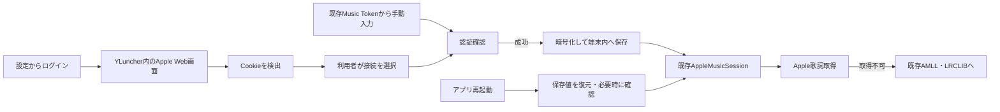

# Apple Music接続情報の保持と組み込み取得画面

2026-11-04。次の設計としてユーザーが依頼。取得画面をYLuncher内へ組み込む方針はユーザー選択済み。本書は設計であり、アプリ実装・新しい依存の導入・ベータ更新はまだ行っていない。

## 確認した資料と現状

- ユーザー提供 `MusicToken-source.zip`、SHA-256 `33f6bdcf43b5292ff52acd2789a11c7851db53a55068b212eb64d62a4bb7ce66`。13エントリ、展開時合計59,745 bytes。ZIP内のソース/README/manifest/バックアップ規則/ビルド依存を読み取り、ビルドスクリプトを実行していない。README内の作業指示は添付資料として扱い、実行許可に読み替えていない。
- `local.musictoken` 1.0 / 1はGT8Dへ導入済み。ユーザーはこの端末でトークン取得に成功したと回答。司令塔がAppleへのログインを再実行したわけではない。
- Music Tokenの元の署名鍵はユーザーの手元にない。既存版の上書き更新は計画しない。既存アプリは残す。ユーザーは「取得画面をYLuncher内に組み込む」を選択した。
- MainActivity.javaはアプリ専用WebViewでApple Musicを開き、CookieManagerからmusic.apple.comに適用されるmedia-user-tokenを取得してコピーする。独自の保存先はなく、CookieはWebView内に保持。外部アプリ向けの結果返却/Service/Providerはない。Cookie期限はAndroidX WebKit 1.8.0のGET_COOKIE_INFO対応時だけ読み、不明時に推測しない。
- TokenLogic.javaはCookie名の完全一致、最初の `=` 以降の値を保持、`+`/`%`/`=`をdecodeしない。HTTPSのapple.com/そのサブドメイン、userinfoなし、443/既定ポートを許可。元の純粋テスト21ケースはREADMEの報告であり、今回再実行していない。
- YLuncher beta2 / 42はAppleMusicSessionのprivateメモリ保持のみ。プロセス終了/上書き更新で失われる。接続済みjpの実通信は以前に確認済みだが、Apple歌詞の実データ採用は未確認。背景改善は別途完了済み。

## 利用者の流れ

1. 設定 → 音楽 → Apple Musicの歌詞 → **Apple Musicにログイン**。
2. YLuncher内の取得画面にAppleのWebページを表示。パスワード/二段階認証はAppleのページへ入力する。
3. Cookieを検出したら **このアカウントで接続** を押す。トークン本文を画面へ表示/コピーせず、内部の接続処理へ渡す。
4. YLuncherが既存のstorefront取得で認証を検証し、成功した値を暗号化保存する。「接続済み（地域: jp）」と「この端末に保存済み」を表示する。
5. 次回は保存値を読み、必要時に認証を再確認して歌詞を取得する。ホーム表示を待たせない。再起動/プロセス再作成/同署名の更新後に貼り直す必要をなくす。
6. 認証が無効になったら「再ログインが必要」と案内し、同じ取得画面へ進める。通信が一時的に失敗しただけなら保存値を消さない。

既存Music Tokenとはアプリ領域が別で、Cookie一式は引き継げない。組み込み画面では初回の再ログインが必要。既存Music Tokenの値を利用するためのマスク付き手動入力も残し、こちらも接続成功後に同じ暗号化保存へ流す。

## 保存するものと境界

- 保存対象は認証成功済みmedia-user-token、検証したstorefront、取得元(組み込み/手動)、確認日時、取得できた場合のみCookie期限。Cookie期限は表示用の情報で、サーバー側の有効期限とは扱わない。180日などの推定値を作らない。
- Android Keystoreの非エクスポート鍵とAES-256-GCMを使う。毎回新しいIV、128bit認証タグ、スキーマ版を認証対象へ含める。暗号文は `noBackupFilesDir` 配下へ原子的に保存。トークン上限は既存16KiBを維持し、読み取りもファイル上限を設ける。
- 自動再接続のため、鍵の利用ごとに生体認証を要求しない。通常のcredential-protected領域を使い、端末の起動前アンロックを回避するDirect Boot対応は追加しない。GT8DでKeystoreが使えるかは実装時に実機検証し、ハードウェア保護と断定しない。
- 保存/復号に失敗した場合は平文へ切り替えない。「保存できません」等の固定文言を出す。メモリ上だけで接続が成立した場合は「この起動中のみ」と区別し、保存済みと表示しない。
- 通常のconfig.json、設定バックアップ、ログ、例外メッセージ、URL、Intentのdata/extras、SavedState/rememberSaveable、画面の説明文へトークンを入れない。秘密を含む値はdata classの自動toString等で公開しない。
- Apple歌詞本文は引き続きメモリキャッシュのみ。トークン保持の変更を歌詞の永続保存へ拡張しない。

## WebViewログイン情報の扱い

暗号化する接続用トークンと、WebViewが管理するCookie/Webストレージは別の保存物である。WebViewの内部DBまで独自AES暗号化されるとは説明しない。

- WebViewは取得画面を開いた時だけ作り、離脱時に通信停止・ポップアップ破棄・destroyする。ホーム/パネル/通常の復元処理からWebViewを初期化しない。常駐ポーリングやバックグラウンドの自動ログインはしない。
- ログインをやり直しやすいようにWebViewのCookieはYLuncherのアプリ領域に保持する。バックアップ規則ではWebView領域もクラウド/端末移行から除外する。現状YLuncherのmanifestにはバックアップ規則がないため、実装で明示する。既存ランチャー設定のバックアップを一律停止する変更は含めない。
- プロジェクトに既存WebView利用は見つからなかった。初期版はこのログイン用の領域だけを扱う。具体的なWebView保存ディレクトリと除外規則は使用プロファイルを決めて照合し、将来別のWebViewを追加する時にも削除範囲を見直す。
- 「接続を解除」はメモリ/暗号化保存/Apple歌詞キャッシュを無効化し、自動復元を止める。「この端末のAppleログイン情報も削除」の選択肢を確認画面に設け、初期選択はON。ON時は組み込みWebViewのCookie/Webストレージ/キャッシュも削除する。既存Music TokenやApple Music本体のログイン情報には触れない。ローカル削除がApple側の全トークン失効操作であるとは扱わない。
- 認証失敗時は保存したトークンを以後利用せず、再ログインを案内する。WebViewに残る同じ値を無条件に自動取得して再試行し続けない。

## 取得画面の構成

- 非exportedの `AppleMusicWebLoginActivity` を同じYLuncherプロセスに設ける。外部URLを引数で受け取らず、開始URLは固定 `https://music.apple.com/`。Activityの結果は成功/中断等の非秘密な状態だけ。トークンは同一プロセスの接続担当へ直接渡し、ActivityResult経由では返さない。
- Music TokenからCookie解析、期限解析、Appleの認証ポップアップ(最大3個)、戻る/再読込/PC表示切替の知見を移す。外部ビルドスクリプト/署名生成/コピー用UIは取り込まず、既存Gradleへ統合する。
- パスワードはアプリ独自の入力欄へ集めない。JavaScriptのネイティブブリッジ、WebViewデバッグ、file/contentアクセス、HTTP/mixed content、SSLエラーの無視は有効にしない。元コードの有効化されていない機能を追加しない。
- 上位画面/ポップアップの遷移は元のApple HTTPS境界を引き継ぎ、紛らわしい別ドメイン、userinfo、443以外、intent/custom schemeを拒否。about:blankは信頼済みApple画面からのポップアップの初期状態に限る。URL本文をログへ出さず、表示するのは検証済みoriginだけ。
- Cookie取得は画面が前面の間だけ。接続ボタンを押した時に再取得し、検出済みの古いコピーを使わない。文字列はdecodeせず、制御文字/既存サイズ制限で検証する。
- GET_COOKIE_INFO非対応なら期限表示なしで接続可能とする。新依存は元アプリと同じAndroidX WebKit 1.8.0を第一候補とし、実装前に既存依存・R8・API利用との整合を確認する。取得画面以外の通常再生経路に依存を初期化しない。
- WebViewがない/無効、認証エラー、SSLエラー、画面再作成、プロセス死亡、中断は固定文言で安全に終了できる。手動入力の経路は残す。

## 復元・更新・解除の状態管理

既存Sessionの「古い要求を新しい接続へ反映しない」世代管理を、永続化まで延長する。読み込み/書き込み/削除は直列化し、I/Oと通信はUIをブロックしない。

| 状況 | 接続/保存の動き |
|---|---|
| 保存なし | 未接続。Webログイン/手動入力へ |
| 起動・復元中 | ホームは表示。新しい保存値を読み終える前に古い要求を開始しない |
| 保存あり・未検証 | 保存済みと接続済みを区別。歌詞利用または設定表示が必要になった時に既存storefront APIで確認 |
| オフライン/timeout/429 | 保存値は維持。AMLL/LRCLIBへフォールバック。待ち時間を守り、メタデータ更新ごとに認証を繰り返さない |
| 認証拒否 | 既存Clientが公開Bearerを更新しても401/403が続き、AUTH_REQUIREDを返した場合に現世代だけを無効化し、保存値も削除。再ログイン待ちへ |
| 差し替え入力 | 入力受領後は既存と同様に旧接続を無効化。旧保存値を削除し、成功した新値だけ保存。失敗後の再起動で旧アカウントを勝手に復活させない |
| 解除 | 世代を進め進行中要求を中断。保存削除完了後に解除完了を表示。遅れた保存/復元/認証結果で復活させない |
| 保存失敗 | 保存済みと報告しない。平文へフォールバックしない |
| 破損/鍵不在 | 起動を止めず再接続が必要な状態へ。不明なファイル形式を解釈しない |

- 復元はプロセスごとに1回だけ開始し、手動接続/解除が先行したら遅い復元を無視する。
- 通信認証の完了と永続化の完了を区別する。キャンセルされた接続を保存しない。公開状態に秘密値を持たせない。
- 明示解除はバックグラウンド保存の完了と競合しても最終的に解除状態となる。完了前にプロセスが終了したケースまで完了済みとは表示しない。
- 認証の自動更新は約束しない。Apple側の有効性はHTTP応答で判断する。トークンが不明な形式でもJWT等と決めつけて解析しない。

## 検証の条件

- 保存: 再読込、別IV、改ざん/切断/巨大ファイル/未知版、鍵不在、I/O失敗、平文不在、backup除外、削除、並行する保存/解除/復元。合成トークンで検証する。
- 接続: 保存成功と通信成功の区別、オフライン時の維持、公開Bearer更新後も続く401/403によるAUTH_REQUIRED時の削除、手動差し替え、旧世代の遅延完了、新プロセスでの復元、既存Apple→AMLL→LRCLIB優先順とキャッシュ失効。最初の401/403だけで利用者のトークンを消さず、既存Clientの再試行境界を保つ。
- Web: 元のCookie/URL解析21ケースを移植して保持し、制御文字/サイズ、ポップアップ/戻る/SSL拒否/外部URL/期限不明/押下時再取得/中断/プロセス再作成を追加。現行のmasked input/no-secretログ/SavedState非保持の検証も維持。
- 既存UIの「再起動後は再入力」の文言だけは新仕様と矛盾するため、実装指示書に新文言と対応テスト移行を明記する。失敗を見て期待値を決めず、文字の可視性/秘密値非混入などの基準は緩めない。
- GT8D: 利用者のAppleログイン→接続/保存→プロセス再作成→ベータ上書き→端末再起動→再入力なしで復元。解除後の再起動で復活しないこと、通信不能でも保存値を消さないこと。実機Keystore動作とログ/設定バックアップに秘密値が出ないことを確認する。
- Apple歌詞の実機採用はまだ未確認なので、Lemonと別曲で取得・解析・表示を同じベータの検証に含める。初期認証だけで全体合格にしない。

## 決めたこと

- ユーザー選択に従い、Music Tokenの取得画面をYLuncherへ組み込む。別アプリとのIPCや署名鍵の再発行は初期範囲に含めない。
- 既存Music Tokenは残す。組み込み側は初回再ログイン、手動入力は補助経路として維持する。
- 検証済みトークンを端末内で暗号化保持し、復元は通常表示を待たせない。保持と失効時の再認証を区別する。
- WebViewのログイン情報は別管理とし、バックアップ除外と解除時の削除を設計に含める。通常のホームでWebViewを常駐させない。
- 本書は設計まで。具体的な変更ファイル/コマンド/allow、ベータ版番号は実装の着手時に確定する。

## 一次資料

- [Android Keystore](https://developer.android.com/privacy-and-security/keystore): 鍵を非エクスポートで扱う。端末のハードウェア実装までは保証しない。
- [Android Auto Backup](https://developer.android.com/identity/data/autobackup): noBackupFilesDirの除外、cloud-backup/device-transfer規則。
- [Androidアプリ署名](https://developer.android.com/studio/publish/app-signing): 同じ署名による更新、異なる署名時の別パッケージ。
- [アプリサンドボックス](https://source.android.com/docs/security/app-sandbox): 他アプリの私有データは直接共有されない。
- [CookieManagerCompat](https://developer.android.com/reference/androidx/webkit/CookieManagerCompat): Cookie情報取得API。
- [ActivityResultRegistry実装](https://github.com/androidx/androidx/blob/androidx-main/activity/activity/src/main/java/androidx/activity/result/ActivityResultRegistry.kt): 未配信の結果をSavedStateへ保持するため、結果Intentへ秘密値を入れない設計にした。
